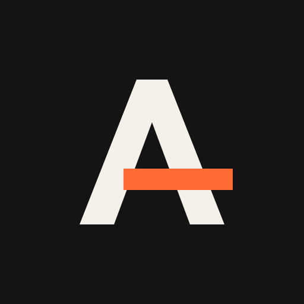

  

<h1 align="center">thouaditya studio</h1>

  Websites and short-form video for local businesses across India. 
  Gyms, cafés, coaching centres, studios, clinics and shops that are great offline but invisible online.

---

## What I build

| | |
|---|---|
| **Websites that bring enquiries** | Mobile-first sites with WhatsApp enquiry buttons, booking and enquiry forms, timings, menus and Google reviews in one place. |
| **Small systems, not just pages** | Batch finders, trial booking with an owner dashboard, "build your package" forms that send the full requirement straight to WhatsApp. |
| **Reels and motion graphics** | Edited reels and motion graphics so a business's real work actually gets seen on Instagram. |

## Featured work

- **[fitnessnine11.com](https://fitnessnine11.com)** — live website for a fitness business.
- **[Personal OS](https://github.com/<your-username>/personal-os-showcase)** — my own CRM that finds leads, drafts messages and handles WhatsApp follow-ups. Source private, built as a product.
<!-- Add each new client site here once the client says it's okay to feature them:
- **[Client name](https://their-site.com)** — one line on what you built and the result. -->

## How I work

1. **Look first.** I study the business's reviews, Google listing and Instagram to find the one problem costing them customers.
2. **Free sample.** A working preview built around their real details, so they can try it on their own phone.
3. **Live in days.** Deployed on the client's own domain and hosting account, so they own it.
4. **Monthly care (optional).** Updates, new offers and photos, hosting and reels.

## Stack

Next.js · TypeScript · Tailwind CSS · Supabase · Vercel / Cloudflare · built with AI-assisted development (Claude Code)

## Contact

- Instagram: [@thouaditya](https://instagram.com/thouaditya)
- WhatsApp: [+916202447993]
- Email: `<adityaranjan.me@gmail.com>`

Client repositories are private. Live sites and case studies are shared with each client's permission.
